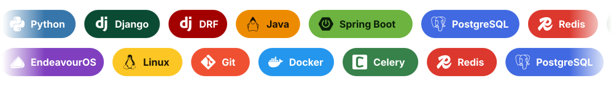

<div align="center">



<br/><br/>

[](mailto:belammuia0@gmail.com)
[](https://www.linkedin.com/in/belam-muia-a690b326a/)
[](https://github.com/belammuia/task-queue-system)

</div>


## ⚙️ how i build

| | principle | what it looks like |
|---|---|---|
| 🔁 | **idempotent by default** | retries should be safe, double-clicks should be boring. same request, same result, zero duplicate work. |
| ⏳ | **async where it counts** | slow work (images, emails, exports) leaves the request path and lives in worker pipelines. |
| 🗄️ | **the database is a feature** | deliberate schema design and query tuning (`select_related` / `prefetch_related`) before reaching for hardware. |
| 🔇 | **quiet in production** | the best systems page nobody. boring, observable, predictable. |


## 🧰 stack



- **core & frameworks:** Python, Django, DRF, Java, Spring Boot
- **data & async:** PostgreSQL, Redis, Celery
- **infrastructure & OS:** Linux (EndeavourOS), Docker, Git


## 🚀 featured systems

### [task-queue-system](https://github.com/belammuia/task-queue-system)
> asynchronous task queue and execution dashboard.



- custom **DRF idempotency middleware** using `Idempotency-Key` headers and Redis caching
- background **worker pipelines** for PIL image resizing, email delivery, and data exports

<br/>

### [momAid-backend](https://github.com/rufoabrahamguyo/momAid-backend)
> cloud-hosted maternal health API built with Django REST Framework and PostgreSQL.



- relational schema design and query optimization (`select_related` / `prefetch_related`)
- scheduled **Celery** tasks for background work


## 🔭 currently

```diff
+ shipping:     real-time systems with WebSockets
+ leveling up:  security & GRC (CompTIA Security+ in progress)
+ sharpening:   async patterns, caching strategy, and API design
- avoiding:     anything that needs a 3am page
```

## 💬 ask me about

`idempotency keys` · `celery gotchas` · `taming the django ORM` · `designing APIs that survive retries` · `living on a rolling-release distro`


## 📊 the receipts

<div align="center">


<picture>
  <source media="(prefers-color-scheme: dark)" srcset="https://raw.githubusercontent.com/belammuia/belammuia/output/github-snake-dark.svg" />
  <source media="(prefers-color-scheme: light)" srcset="https://raw.githubusercontent.com/belammuia/belammuia/output/github-snake.svg" />
  
</picture>

</div>


<div align="center">

*if it runs in prod and no one notices - perfect.*

<br/>


</div>
